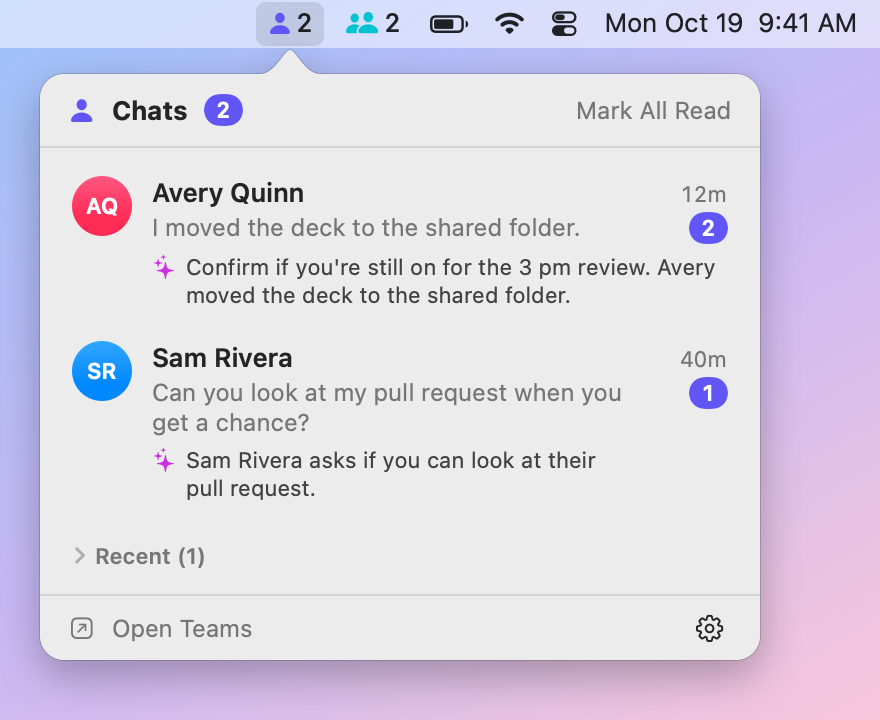

# Teams Pulse

[](https://github.com/mnsn/teams-pulse/actions/workflows/ci.yml)
[](LICENSE)

A small macOS menu-bar app that shows your unread Microsoft Teams chats at a glance: one item for
**1:1 chats** and one for **group chats**, each with a count and its own list. Click a chat to open
it in Teams, at the first message you haven't read.

It needs no server, no sign-in and no Microsoft Graph permission. It reads the notifications that
Teams already sends to macOS Notification Center, on your Mac, and nothing about your chats leaves
it.

<p align="center">
  <picture>
    <source media="(prefers-color-scheme: dark)" srcset="docs/images/menubar-dark.png">
    
  </picture>
</p>

> [!NOTE]
> Teams Pulse is an independent project. It isn't affiliated with or endorsed by Microsoft.

## Features

- **Two menu-bar items**: **Chats** (1:1) and **Group Chats** (group and meeting chats). Each shows
  how many chats have unread messages, and just its icon when none do. Click one for its list.
- **The latest message**: each chat shows its newest unread message (with the sender in group
  chats), how long ago it arrived and how many are unread. Hover for the last few.
- **One click to the chat**: opens it in Teams at its oldest unread message, and marks it read.
- **What it's about**: hover over a chat and click ✨ for a one-sentence summary from Apple's
  on-device model (Apple Intelligence, on macOS 26 or later). It runs on your Mac.
- **Nothing missed**: it keeps unread chats even after Notification Center drops their
  notifications, and notifications delivered during a Focus count too.
- **Instant**: it watches Notification Center's database as it's written, without polling.
- **Private**: it only reads, sends nothing about your chats anywhere, and keeps only your unread
  chats on disk, encrypted, until they're read.

## What counts as unread

Notification Center doesn't record what you've read, so Teams Pulse decides:

| A chat becomes | When |
|---|---|
| **Unread** | Teams posts a notification for a new message, while Teams Pulse runs or while it doesn't |
| **Read** | You open it from Teams Pulse, or choose **Mark as Read** or **Mark All Read** |
| | You click or clear its notification in Notification Center |
| | Its newest unread message is older than **Keep Unread For** (1 day by default) |
| | Optionally, Teams' dock badge disappears (see [Settings](#settings)) |

Reactions to your messages and channel posts aren't unread chats, so they aren't counted. Read chats
stay under **Recent** for a day.

Teams Pulse can't see you read a chat in Teams itself, unless that removes its notifications or
clears Teams' dock badge. **Keep Unread For** and **Mark All Read** cover the rest.

## Install

Requires macOS 15 or later, on Apple silicon or Intel.

1. Download [**Teams-Pulse.zip**](https://github.com/mnsn/teams-pulse/releases/latest/download/Teams-Pulse.zip)
   from the [latest release](https://github.com/mnsn/teams-pulse/releases/latest) and unzip it.
2. Drag **Teams Pulse** to your Applications folder before you open it. Opened from Downloads,
   macOS runs it from a temporary location, and Full Disk Access, Launch at Login and updates may
   not work.
3. Open it. The app isn't notarized by Apple, so the first time, macOS won't open it because it
   can't verify it. Click **Done**, then go to **System Settings › Privacy & Security**, scroll
   down to the message that Teams Pulse was blocked, click **Open Anyway** and confirm.
4. A window walks you through giving it **Full Disk Access**, which it needs to read Notification
   Center's database: click **Open Privacy Settings** and turn on **Teams Pulse**. If it isn't in
   the list, click **+** under the list and choose it in Applications, or drag it there from Finder.
   Choose **Quit & Reopen** if macOS offers it. Changing the list asks for your password or Touch
   ID, and an administrator's on a standard account.
5. Turn on **Launch at Login** in its settings. If macOS asks you to allow it, use
   **Allow in Login Items Settings…**.

The second time you open it, Teams Pulse asks whether to check for updates automatically. If you
allow it, it checks once a day and offers each new version, which it installs and reopens without
the Gatekeeper step. Updates keep its Full Disk Access. **Check for Updates…** in its settings
checks right away. To remove it, quit it, move it to the Trash and remove it from the Full Disk
Access list.

On a Mac that your organization manages, **Open Anyway** may be missing, or a profile may keep you
from granting Full Disk Access. Your IT department can grant it for you, as described next.

### For organizations: no Full Disk Access step

On Macs your organization manages, IT can grant Teams Pulse Full Disk Access ahead of time, so its
users never see that step. With this repository cloned,
`scripts/make-pppc-profile.sh "/Applications/Teams Pulse.app"` writes a configuration profile for a
release, to deploy with your MDM (for example, in Intune, as a custom macOS configuration profile).
macOS ignores it if it's installed by hand. The profile names the app's signing certificate, which
every release shares, so it covers later versions too. For copies you build yourself,
`make pppc-profile` writes one for their certificate instead.

### Build from source

You need Swift 6, from Xcode or the Command Line Tools (`xcode-select --install`). An app you build
yourself opens without the Gatekeeper step.

```sh
git clone https://github.com/mnsn/teams-pulse.git
cd teams-pulse
make signing-identity   # once per Mac: the certificate every build is signed with
make install            # builds "Teams Pulse.app", copies it to ~/Applications and opens it
```

Then give it Full Disk Access as above: it's in `~/Applications` (press ⌘⇧G in the file dialog to
type the folder). To remove it, run `make uninstall` and remove it from the Full Disk Access list.

A copy you build updates itself too, to the release builds, unless you turn off
**Check for Updates Automatically** and build each new version yourself. Releases are signed with
the project's certificate rather than yours, so after that first update, macOS asks for Full Disk
Access again: remove Teams Pulse from the list and add it again. macOS may also ask once whether
Teams Pulse can use its keychain item: click **Always Allow**.

### Why the signing certificate?

macOS ties Full Disk Access to the app's code signature. An ad-hoc signed app (the usual for a local
build) is identified by the hashes of its code, so every rebuild looks like a new app and loses
access. `make signing-identity` creates a self-signed certificate, **Teams Pulse Signing**, in your
login keychain, and every build is signed with it, so each new build keeps the access you granted.
The first build may ask whether `codesign` may use the key: choose **Always Allow**. Releases work
the same way, with the project's own certificate, which is why updates keep the access.
[How it works](docs/how-it-works.md#signing) has the details.

### Teams' notifications

Teams Pulse sees only what Teams sends to Notification Center, so check that:

- **System Settings › Notifications › Microsoft Teams** allows notifications, with
  **Show in Notification Center** on.
- In Teams' own settings, under **Notifications and activity**, chat notifications are on.

Chats you muted, and messages that arrive while Teams' own status is **Do not disturb** or while
you're looking at the chat, don't produce notifications, so Teams Pulse doesn't see them either.
A macOS Focus is fine: notifications are still stored.

## Settings

Open the gear menu in either list.

| Setting | Options |
|---|---|
| Keep Unread For | 4 hours, 1 day (default), 3 days, until I read it |
| Show Message Previews | on/off: off shows only how many messages are new, for screen sharing |
| Summarize with Apple Intelligence | on/off: the ✨ button on each chat, while previews are shown |
| Mark All Read When Teams' Badge Clears | off by default: when Teams' dock badge disappears, everything counts as read |
| Launch at Login | on/off |
| Check for Updates Automatically | on/off (once a day) |

**Check for Updates…** checks right away. **Copy Diagnostics** copies a description of the
database's structure, without names, messages or IDs, for an issue report.

## Privacy

- **Nothing about your chats leaves your Mac.** No sign-in, no Graph and no telemetry. The only
  network requests are for Teams Pulse's own updates, from this project's releases on GitHub, and
  only if you allow them: a small file that describes the latest release, once a day, and the new
  version when you install it. GitHub sees your IP address and the versions of Teams Pulse and of
  [Sparkle](https://sparkle-project.org), the updater it uses. The app's own code has no networking
  at all.
- **It only reads** Notification Center's database, with a read-only connection, and never changes
  it.
- **Summaries are made on your Mac**, by Apple's on-device model, never Apple's Private Cloud
  Compute, and are kept in memory only.
- **On disk**, it keeps only your unread chats (the chat's name, and the unread messages' sender and
  text), so they survive a restart after Notification Center has dropped them. They're encrypted
  with a key in your login keychain, in a file only you can read, that Time Machine skips. A chat
  leaves the file as soon as it's read, and the file is deleted when nothing is unread. It also
  stores when it last ran and its settings, which say nothing about your chats.
- Its log never contains names, messages or chat IDs.

## FAQ

### Why does it need Full Disk Access?

Notification Center keeps notifications in a database under
`~/Library/Group Containers/group.com.apple.usernoted`, which macOS protects. Full Disk Access is
the only permission that lets an app read it. Teams Pulse reads nothing else.

### Will a macOS or Teams update break it?

It could: neither Notification Center's database nor Teams' notifications are documented. Teams
Pulse checks both every time it reads them. If the database's layout changes, it says so in its lists
instead of guessing, and if Teams' notifications change so that it can't read them, it says how many
it couldn't read. **Copy Diagnostics** describes what changed, without your data.

### Which languages can it summarize?

Those Apple's on-device model supports, which depend on your macOS version. For others it may still
manage, or it says it can't. Summaries need macOS 26 or later, and Apple Intelligence turned on in
System Settings.

### My Mac is managed by my organization. Will it work?

Usually, but an MDM profile can keep you from granting Full Disk Access, and security software may
flag an app that reads Notification Center's database. Check your organization's policy first. IT
can also [grant the access for you](#for-organizations-no-full-disk-access-step).

### Why isn't it notarized?

Notarization needs a paid Apple Developer Program membership, which this free project doesn't
have. So macOS asks you to allow the app the first time you open it, as described in
[Install](#install). Each release is built from its tagged source by
[GitHub Actions](.github/workflows/release.yml), with an attestation you can
[verify](SECURITY.md#verifying-a-download). You can also build it yourself.

### How do I know an update is genuine?

Each update, and the file that announces it, is signed with the project's private key. Teams Pulse
installs an update only if both signatures match the public key built into the app. Only the
maintainer holds the private key, and so does the release workflow, which can use it only after the
maintainer approves the release. Every release is also signed with the same certificate, which is
what keeps Full Disk Access. [SECURITY.md](SECURITY.md#how-updates-are-verified) has the details.

### How do I troubleshoot it?

The app binary has command-line options, and logs to the system log:

```sh
APP="/Applications/Teams Pulse.app/Contents/MacOS/TeamsPulse"   # ~/Applications after make install
"$APP" --diagnose   # the database's structure only: safe to share
"$APP" --dump       # unread and recent chats
"$APP" --watch      # messages as they arrive, and chats as they're read
"$APP" --summaries  # a summary of each unread chat, from the on-device model
log show --last 10m --info --predicate 'subsystem == "com.asaf.TeamsPulse"' --style compact
log show --last 1d --predicate 'subsystem == "org.sparkle-project.Sparkle"' --style compact   # updates
```

Run from Terminal, they use Terminal's Full Disk Access. `--dump`, `--watch` and `--summaries` print
names and messages, so keep their output to yourself.

## Contributing

[CONTRIBUTING.md](CONTRIBUTING.md) explains how to build, test and try the app with made-up chats.

## License

Copyright © 2026 Asaf Manassen. Teams Pulse is free software, licensed under the
[GNU General Public License v3.0 or later](LICENSE).

Microsoft Teams is a trademark of the Microsoft group of companies.
